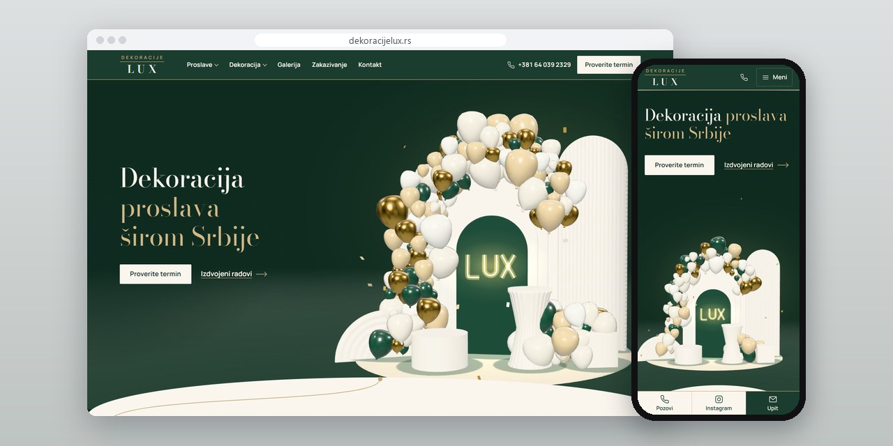
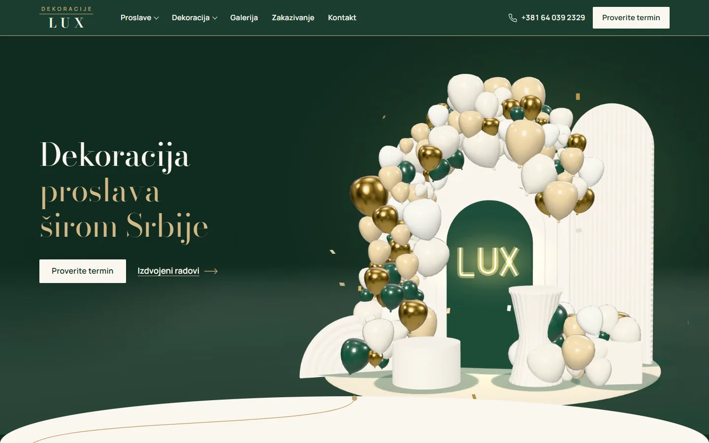
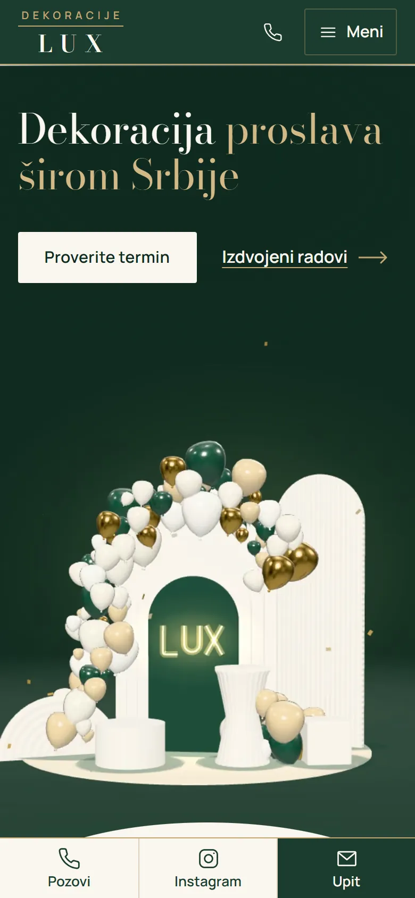
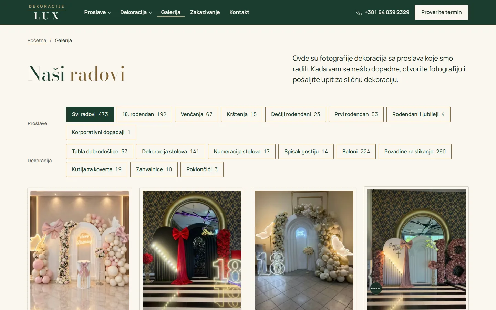
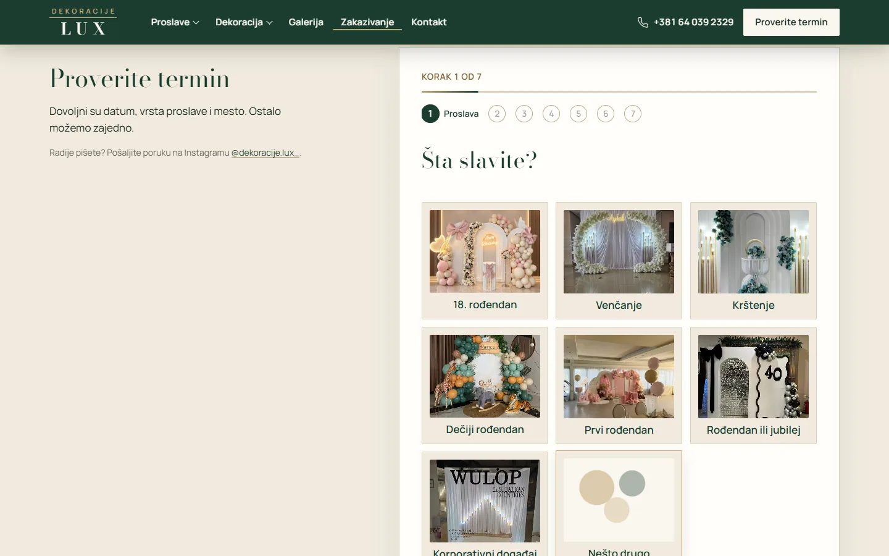

# Dekoracije Lux

Site for a celebration decorator from Šabac: a page for every celebration and decoration type, 473 photos and a seven-step booking inquiry.

**[dekoracijelux.rs](https://dekoracijelux.rs/)** · [Case study (in Serbian)](https://svilenkovic.rs/radovi/dekoracije-lux) · [Srpski](README.sr.md)

> [!NOTE]
> Client project. The source code belongs to the client and stays in a private repository. This page describes what I built and how.

<table>
  <tr><td><b>Client</b></td><td>Dekoracije Lux</td></tr>
  <tr><td><b>Industry</b></td><td>Decorations for birthdays, weddings, christenings and events</td></tr>
  <tr><td><b>Location</b></td><td>Šabac, Serbia</td></tr>
  <tr><td><b>Type</b></td><td>Multi-page website</td></tr>
  <tr><td><b>My role</b></td><td>Design, development, SEO, hosting and maintenance</td></tr>
  <tr><td><b>Stack</b></td><td>PHP 8.3, SQLite, Three.js, GSAP, nginx</td></tr>
</table>

## About the project

Dekoracije Lux is based in Šabac and decorates 18th birthdays, weddings, christenings, children's birthdays and corporate events all over Serbia. People pick a decoration with their eyes first and ask about the date and price later, so the site follows that order: real photos lead to an inquiry, and the inquiry asks only for what is needed to put together a proposal.

Each of the seven celebrations and each of the nine decoration types has its own page, and the gallery holds 473 photos that filter by celebration and by decoration. When a photo is opened, one button carries it into the inquiry form, which goes step by step and requires only the celebration, the date and the place. On the homepage a 3D balloon scene changes as you scroll and ends in an arch with a LUX sign; Three.js draws it in a Web Worker, and visitors with reduced motion or a weaker device get a finished image of the same scene.

## What I built

- 21 pages: one for each of the seven celebrations and nine decoration types, plus the gallery, booking, about and contact
- A gallery of 473 photos with filters by celebration and decoration type, and a button that carries a photo into the inquiry
- A seven-step inquiry with photo cards, up to three inspiration photos and a choice between a call and an email, stored in SQLite
- A balloon colour catalogue on the balloon page, so colours can be named in the inquiry
- Pages generated in advance from PHP templates, libraries served from the same domain and analytics only after consent
- Mobile PageSpeed 100 in all four categories, measured on 10 October 2026

## Results

| | Performance | Accessibility | Best practices | SEO |
| :-- | :-: | :-: | :-: | :-: |
| Mobile | 100 | 100 | 100 | 100 |
| Desktop | 100 | 100 | 100 | 100 |

PageSpeed Insights, lab test of the live site, October 2026. Security headers: 6 of 6. axe accessibility check: no violations. Structured data: `FAQPage`, `LocalBusiness`.

## Screenshots

<table>
  <tr>
    <td width="68%" valign="top"></td>
    <td width="32%" valign="top"></td>
  </tr>
</table>

Gallery of 473 photos with filters by celebration and decoration type

First of the seven inquiry steps: choosing the celebration on a photo card

---

Built by [D. Svilenković](https://svilenkovic.com).
